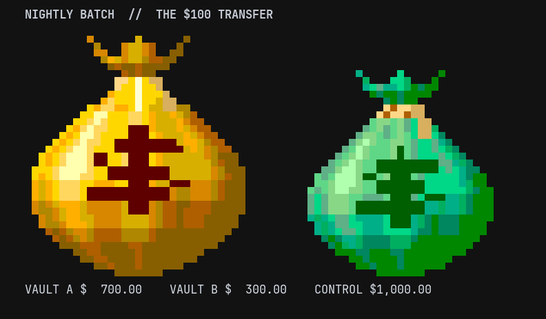

# COBOL Moneybags

The auditor asked to see the movement of funds.



## Run it

Use GnuCOBOL and a UTF-8 terminal with 256-color support. An 80×24 window is enough.

```sh
cobc -free -O2 -x moneybags.cob && ./moneybags
```
